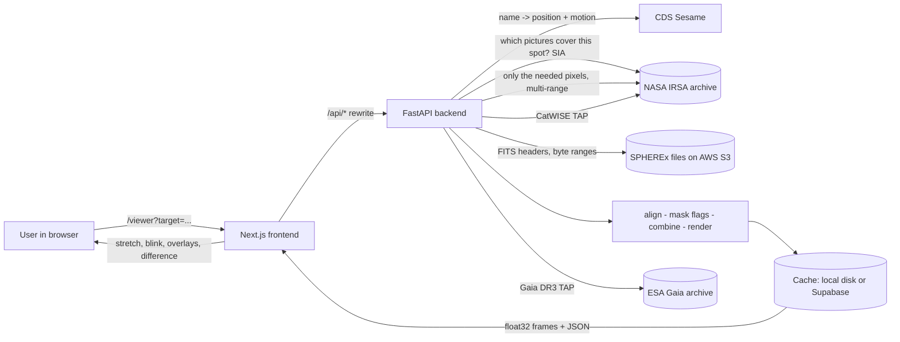
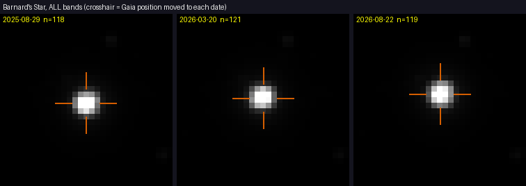
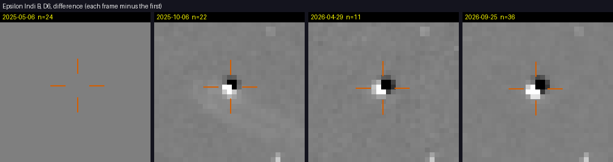
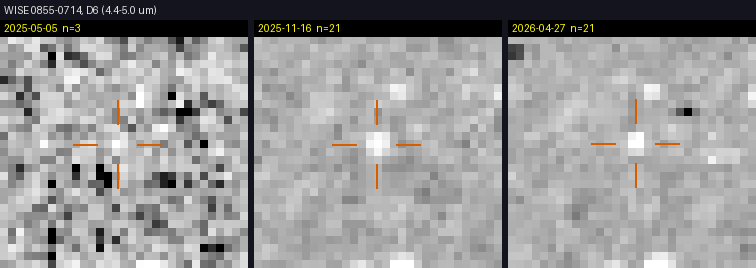
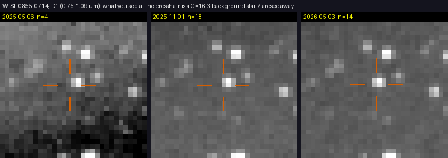
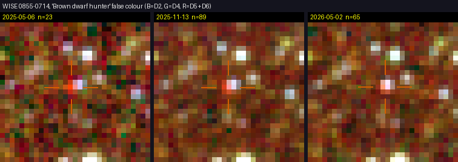
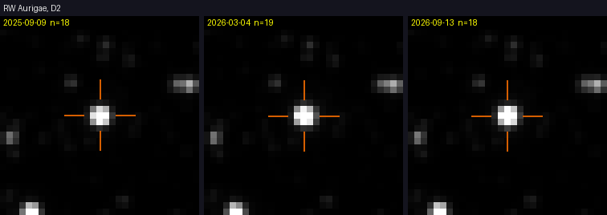
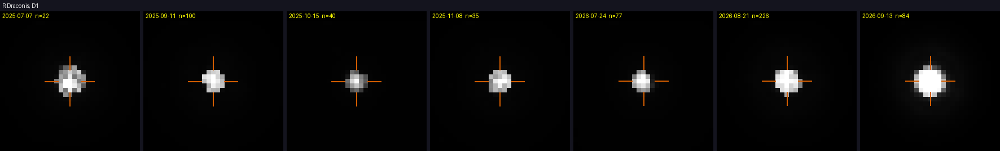

# Nexus Viewer — the project explained

*For Team Nexus: everything you need to understand, demo and defend the project. No astronomy background assumed. Words in **bold** the first time are in the [glossary](#12-glossary) at the end.*

---

## 1. What the project does, in one paragraph

You type a star's name (for example "Barnard's Star") or a position in the sky. The website asks NASA's archive for **every picture the SPHEREx space telescope has taken of that small patch of sky** (often 250–500 pictures), cuts out the patch from each one, lines them all up so north is up, and combines the pictures taken during each six-month sky survey. It then plays them like a **flip-book**. Anything that moves (a nearby star, a cold brown dwarf, an asteroid) or changes brightness (a pulsating star) jumps out when the frames blink. You can also click any star to measure its brightness in every single picture, which gives you its colour spectrum from 0.75 to 5 micrometres and a light curve (brightness over time), computed on the spot.

## 2. The science, simply explained

### What is SPHEREx?
SPHEREx is a NASA space telescope launched in March 2025. It photographs the **whole sky** in **infrared** light (light with longer wavelengths than red, which our eyes cannot see), between 0.75 and 5 **micrometres** (µm). It orbits the Earth and scans the sky in strips, so **every part of the sky is covered once every six months**. By November 2026 a typical position has been photographed during **three sky surveys** (we checked: Barnard's Star has 363 pictures spread over Aug 2025 → Sep 2026). Near the **ecliptic poles** the telescope looks almost every orbit, so places like R Draconis have about 2,500 pictures.

Each picture is 2040 × 2040 pixels and each pixel covers **6.15 arcseconds** of sky. That is coarse: the full Moon is about 300 SPHEREx pixels wide.

### What "102 bands of near-infrared" means
SPHEREx has **six detectors**, D1 to D6, each sensitive to a different range of wavelengths:

| Detector | Wavelengths | What is bright there |
|---|---|---|
| D1 | 0.75–1.09 µm | ordinary stars; pulsating giant stars vary most here |
| D2 | 1.10–1.62 µm | stars |
| D3 | 1.63–2.41 µm | stars, dust-reddened objects |
| D4 | 2.42–3.82 µm | ices and molecules start to absorb |
| D5 | 3.83–4.41 µm | cold brown dwarfs begin to shine |
| D6 | 4.42–5.00 µm | cold brown dwarfs are brightest |

In front of each detector is a **linear variable filter (LVF)**: a filter whose colour changes gradually from one edge of the detector to the other. When the telescope moves on, a star lands on a different part of the filter, so it gets measured at a slightly different wavelength each time. Over many pictures you collect about **17 colours per detector × 6 detectors = 102 colours**. That is why clicking a star in Nexus Viewer gives a spectrum: each dot is one picture, at its own wavelength.

### Why objects move
- **Proper motion**: stars orbit the centre of our galaxy, like the Sun does. Nearby stars appear to drift slowly across the sky. Barnard's Star, 6 light-years away, holds the record at **10.4 arcseconds per year**, which is **0.85 SPHEREx pixel every six months**, or about 2 pixels across the 13 months of data. Small, but clearly visible when you zoom in and blink.
- **Parallax**: as the Earth goes round the Sun, nearby stars seem to wobble back and forth. For the nearest stars this is under 1 arcsecond (a sixth of a pixel), so we ignore it.
- **Orbital motion in the Solar System**: asteroids and comets move so fast (arcminutes per hour) that they appear in only one picture. Use the "All exposures" mode to catch them.

### Brown dwarfs
Brown dwarfs are "failed stars": balls of gas too small to burn hydrogen. They are cool and faint, and shine mostly in the infrared. **WISE 0855−0714** is the coldest one known (about −25 °C). It is practically **invisible in D1–D3 and bright in D5–D6** (4–5 µm). That makes it the best demonstration of why choosing the right band matters. Brown dwarfs near the Sun are usually discovered *because they move*, which is exactly what our flip-book shows.

### Variable stars
- **R Draconis** is a **Mira variable**: a giant star that swells and shrinks every ~245 days, changing brightness a lot, especially at short wavelengths.
- **RW Aurigae** is a very young (T Tauri) star; dusty material from its disk passes in front of it and dims it irregularly.

### Why comparing images over time leads to discoveries
In 1930 Clyde Tombaugh found **Pluto** by "blinking" two photographs of the same sky taken days apart: everything stayed still except one dot. Today the citizen-science project **Backyard Worlds** finds brown dwarfs by blinking images from NASA's WISE telescope (the tool they use, WiseView, inspired our design). SPHEREx re-images the whole sky every six months in 102 colours, so Nexus Viewer lets anyone do the same with brand-new data, plus spectra no blinker had before.

## 3. Walkthrough of every page and control

### `/` Home
Rotating 3-D galaxy background (reused from last year's project), the headline "Catch the sky moving", an animated preview of Barnard's Star made from real SPHEREx frames, a 3-step "How it works" strip, and the five featured targets. Buttons go to Explore or to the Explorer/Researcher choice.

### `/user-types`
Two cards: **Explorer** (simple, guided) and **Researcher** (every control). Same data behind both.

### `/explore` — Explorer mode
- **Target chips** ("Barnard's Star", "WISE 0855-0714"…): one click loads a recommended view.
- **Search box**: a name (resolved by the CDS Sesame service) or coordinates in degrees (`269.446 4.768`) or hours/degrees (`17h57m47s +04d46m06s`).
- **Hint box** (💡): what to look for in this target.
- **The flip-book**, scaled to fill the box, with crosshair and motion arrow.
- **Play / pause / step and speed**: space bar, ← and → also work.
- **Timeline dots**: one per frame, spaced by real date; click one to jump.
- **Make it pop**: raises the contrast so faint things show (bright stars turn white).
- **Show difference**: subtracts the first frame from every frame. Things that did not change turn grey; a moving star becomes a black-and-white pair.
- **Colour of light**: All / Short (D1) / Long (D6) / False colour. Try WISE 0855 in Short vs Long!
- **What am I looking at?**: a side drawer explaining the picture in plain words.
- Clicking the star shows its spectrum underneath.

### `/viewer` — Researcher mode
Top bar:
- **Search box** (same as above), the object name, its coordinates and its proper motion μ.
- **Release picker**: all releases (default) or only DR1 / only QR3. DR1 holds 2025 → May 2026; QR3 holds newer pictures. Use all for the longest time span.
- **Share / export**: copy a link to this exact view, copy `<iframe>` embed code, download an animated GIF, a PNG of the current frame, or a FITS file containing every aligned frame (for real analysis software).

Left panel:
- **Band**: ALL (every detector stacked: the cleanest image, best for motion) or one detector D1–D6.
- **Presets**: *Motion finder* (ALL), *Brown dwarf hunter* (false colour B=D2, G=D4, R=D5+D6: cold brown dwarfs look red, ordinary stars white/blue), *Variable star* (D1), *Ices / molecules* (D4/D5/D6).
- **Narrow channel (102)**: one of the 102 nominal wavelength channels. Only pictures in which the target fell at that wavelength are used.
- **Field of view**: 60″ to 1800″ (30 arcminutes). Larger fields take longer to download the first time (a warning appears above 600″).
- **Frames**: *Epochs* (one frame per visit, i.e. per sky survey; default), *All exposures* (every single picture: noisy but best time resolution, for asteroids), *Stack everything* (one deep picture).
- **Window**: pictures closer together than this many days are combined into one frame (default 30). Near the ecliptic poles use 1–7 days.
- **Difference**: off / minus first frame / minus previous frame / minus the average of the others. Computed instantly in the browser.
- **Stretch**: how brightness maps to grey: linear, asinh (default; good for faint things next to bright stars), log, sqrt, zscale (automatic, like professional tools).
- **Black point / white point**: percentiles of the pixel values that become black / white. The same limits are used for every frame so the blink is fair.
- **Zoom**: 1–16× (pixels stay square unless "Smooth pixels" is on). **Invert**: black stars on white.
- **Overlays**:
  - *Crosshair*: where the catalogues say the target is **on each frame's date** (position moved with its proper motion).
  - *Motion arrow*: where the target will be in 10 years.
  - *Gaia DR3 stars*: blue circles at the positions measured by ESA's Gaia satellite, moved to each frame's date (the 60 brightest in the field). Barnard's Star's circle moves with it.
  - *CatWISE sources*: orange diamonds from NASA's WISE infrared catalogue, which includes faint brown dwarfs.
  - *Bad-pixel flags*: colours pixels the SPHEREx pipeline did not trust: red = saturated/nonlinear, pink = ghost/streak, yellow = transient/persistence, blue = detector defect.
  - *Track target*: off = the sky stays fixed and the target moves (default). On = the view follows the target and the background moves.
  - *Remove zodiacal light*: subtracts the pipeline's model of sunlight scattered by interplanetary dust.

Centre: the image (hover to read coordinates and pixel value, **click to measure**), the playback bar, and tabs:
- **Spectrum**: brightness (µJy) against wavelength, one dot per picture, coloured by survey epoch; log scale and a "102-channel average" view; grey crosses = measurements touching flagged pixels.
- **Light curve**: brightness against date for one detector (choose D1–D6), single pictures in blue and epoch averages in orange.
- **Frames table**: date, number of pictures, detectors, wavelength and release of every frame (click a row to jump to it).

Right: **This frame** (frame number, dates, number of exposures per detector, average wavelength, centre, target position, release and processing version, and which flags occur in the field) and **Sky context** (Aladin Lite showing older surveys, DSS / 2MASS / AllWISE / Pan-STARRS, with a box marking our field).

Keyboard: space = play/pause, ←/→ = step, +/− = zoom.

### `/embed`
The same viewer with no menus, made for `<iframe>`s on other websites (only this page may be framed by other sites). Everything comes from the URL. Has an "Open in Nexus Viewer" link.

### `/targets`
Gallery of the five challenge targets plus three bonus fields (Luhman 16, the North Ecliptic Pole deep field, an asteroid field on the ecliptic), each with an animated preview, an explanation, "what to look for", and Explore / Open in viewer buttons.

### `/learn`
Illustrated explanations: SPHEREx, the 102 colours, why stars move, brown dwarfs, variable stars, reading flags, using difference images.

### `/about`
Team (placeholder: names to be added), data credits and DOIs, inspirations.

### Every view is a link
All settings live in the address bar, for example
`/viewer?target=wise-0855&band=D6&zoom=8&diff=first&gaia=1`. Copy it and anyone sees exactly the same view.

## 4. How the data flows



Step by step (what happens when you open Barnard's Star):
1. **Browser → frontend.** The page reads the URL (`target=barnards-star`) and asks `/api/targets/barnards-star` for the star's catalogue position (year 2000), proper motion and the position moved to 2026.
2. **Frontend → backend.** It sends `POST /api/jobs` with the position, field size, band, etc. The backend answers immediately with a *job id*; the browser then asks `GET /api/jobs/{id}` every second to follow progress. (With Supabase configured it can instead get live updates through Supabase Realtime.)
3. **Backend → IRSA (which pictures?).** One **SIA** query to IRSA lists every SPHEREx Level-2 picture (all six detectors, DR1 + QR3, normal and deep collections) whose footprint contains the position: 358 for Barnard's Star. The list is cached for 24 h.
4. **Grouping in time.** Pictures are sorted by date and split wherever there is a gap longer than 30 days (the "window"). Barnard's Star gives 3 groups = the 3 sky surveys. Very long groups (deep fields) are cut into 30-day pieces.
5. **Downloading only what we need.** Each SPHEREx file is 65 MB, but we only need a ~40×40-pixel corner. The backend reads the file's headers from NASA's public AWS copy, then asks IRSA for just those pixels (one row segment per line, using HTTP "multi-range" requests): about 0.4 MB per picture instead of the 4 MB that IRSA's cutout service sends. IMAGE, FLAGS (bad-pixel bits), VARIANCE (noise) and ZODI (zodiacal-light model) are read; FLAGS is compressed and gets decompressed. Every piece is cached, so it is never downloaded twice. At most 8 requests run against IRSA at the same time (be polite) and failed requests are retried with back-off.
6. **Lining up.** Each cutout is **reprojected** onto one common grid centred on the target: north up, east left, 6.15″ pixels (astropy + reproject). The wavelength each picture saw at the target is read from its **WCS-WAVE** table.
7. **Cleaning and combining.** The zodiacal-light model is subtracted, each picture's background level is removed, flagged pixels are ignored, and the pictures of each group are averaged with **inverse-variance weights** (less noisy pictures count more). The result is one frame per survey plus its combined flag mask.
8. **Storing.** Each frame is saved as raw 32-bit floats (a few kB) with its metadata (dates, exposures, wavelength, flags, statistics). The *request hash*, a fingerprint of all settings plus the data release versions, is the cache key: an identical request is answered from cache in milliseconds, and a new data release automatically changes the key.
9. **Back to the browser.** As each frame is finished it appears in the job status; the browser downloads it (`/api/frames/{id}.bin`) and draws it on a canvas. Contrast, difference images, overlays and blinking are all done **in the browser**, so sliders react instantly.
10. **Click → spectrum.** `GET /api/spectrum` measures the star in a 12″ circle in *every* picture (following its motion when you click the target), subtracts the local sky from a ring around it, and converts to µJy using the solid-angle map of each detector. The first time this takes 1–2 minutes (the endpoint answers "202 still working" and the page polls); after that it is cached.

## 5. Folders and important files

```
nexus-viewer/
├─ PROJECT_EXPLAINED.md          this document
├─ README.md                     developer quick start (commands only)
├─ docker-compose.yml            backend + frontend containers (untested: Docker not installed)
├─ .github/workflows/ci.yml      CI: ruff, mypy, pytest, tsc, eslint, vitest, build
├─ .github/workflows/sync-releases.yml   weekly job that discovers new SPHEREx releases
├─ docs/phase0_findings.md       what we learned probing the real archive (read this!)
├─ docs/phase0_raw.json, phase0_probe_output.txt   raw probe output
├─ docs/img/                     screenshots and frame strips used below
├─ supabase/migrations/0001_init.sql   database schema (tables, security rules, storage buckets)
├─ supabase/seed.sql             the releases and featured targets as SQL inserts
├─ backend/
│  ├─ app/main.py                FastAPI app: CORS from env, routers, error handlers, rate limiter
│  ├─ app/core/config.py         every setting, read from environment variables / backend/.env
│  ├─ app/core/errors.py         "archive down" → HTTP 503 with a friendly message
│  ├─ app/core/ratelimit.py      per-IP request limits on /jobs, /spectrum, /lightcurve
│  ├─ app/api/routes/core.py     /health /resolve /releases /targets /bands /observations
│  ├─ app/api/routes/jobs.py     /jobs, /frames/*.bin|png, /framesets/*/animation.gif|fits
│  ├─ app/api/routes/photometry.py   /spectrum, /lightcurve (asynchronous: 202 then 200)
│  ├─ app/api/routes/overlays.py /overlays/gaia, /overlays/wise
│  ├─ app/services/irsa.py       finds exposures (SIA, TAP fallback), de-duplicates releases
│  ├─ app/services/cutouts.py    downloads only the needed pixels (byte ranges, retries, cache)
│  ├─ app/services/fitsio.py     reads SPHEREx FITS pieces; wavelength lookup; (de)serialisation
│  ├─ app/services/alignment.py  common north-up grid + reprojection
│  ├─ app/services/coadd.py      flag masking, inverse-variance combining, difference images
│  ├─ app/services/epochs.py     grouping pictures in time
│  ├─ app/services/wavelength.py detectors, 102 channels, band strings ("RGB:D2,D4,D6"), presets
│  ├─ app/services/photometry.py forced aperture photometry → spectrum / light-curve points
│  ├─ app/services/overlays.py   Gaia DR3 and CatWISE / AllWISE catalogue queries
│  ├─ app/services/resolver.py   name → position + proper motion (CDS Sesame); motion maths
│  ├─ app/services/render.py     frame bytes, PNG, GIF and FITS-cube output, stretch functions
│  ├─ app/services/cache.py      CacheBackend (local disk or Supabase) and JobStore
│  ├─ app/services/releases.py   reads the release registry (Supabase table or releases.json)
│  ├─ app/workers/job_runner.py  the frame-building pipeline run for each job
│  ├─ app/schemas/models.py      request/response shapes (mirrored in frontend/lib/types.ts)
│  ├─ app/data/releases.json     release registry used when Supabase is not configured
│  ├─ app/data/targets.json      featured targets (generated by scripts/seed_targets.py)
│  ├─ scripts/phase0_probe.py    Phase 0 archive probe
│  ├─ scripts/seed_targets.py    resolves targets, moves them to 2026, writes targets.json / Supabase
│  ├─ scripts/sync_releases.py   discovers / activates SPHEREx releases
│  ├─ scripts/prewarm_cache.py   builds all featured targets + GIF previews
│  ├─ scripts/make_seed_sql.py   regenerates supabase/seed.sql
│  ├─ scripts/docs_images.py     makes the frame strips in docs/img
│  ├─ tests/                     unit, fixture (real SPHEREx cutout), API and live tests
│  ├─ Dockerfile, requirements*.txt, pyproject.toml, .env.example
└─ frontend/
   ├─ app/(site)/…               pages with menu and footer: / explore viewer targets learn about user-types
   ├─ app/embed/page.tsx         chrome-less viewer for iframes
   ├─ components/viewer/SkyViewer.tsx      puts everything together (3 layouts: researcher / explorer / embed)
   ├─ components/viewer/FrameCanvas.tsx    draws a frame + crosshair, catalogue marks, flags, scale bar, compass
   ├─ components/viewer/Controls.tsx       band, field of view, frames/difference, stretch, overlay panels
   ├─ components/viewer/PlaybackBar.tsx    play/pause/step/speed + date timeline
   ├─ components/viewer/MetadataPanel.tsx  "This frame" panel
   ├─ components/viewer/SpectrumChart.tsx  spectrum and light-curve charts (Recharts)
   ├─ components/viewer/AladinPanel.tsx    Aladin Lite sky context
   ├─ components/viewer/ExportMenu.tsx     share link, embed code, GIF/PNG/FITS
   ├─ components/viewer/CoordinateInput.tsx, InfoTip.tsx
   ├─ components/landing/…       galaxy scene, parallax stars, animations (copied from last year)
   ├─ components/ui/…            shadcn/ui components (copied from last year)
   ├─ components/site/…          navigation, footer + data credits, featured-target cards, providers
   ├─ hooks/                     useJob, useFrames, usePlayback, useViewerState, usePhotometry
   ├─ lib/api.ts                 typed client for the backend
   ├─ lib/url-state.ts           viewer settings ⇄ URL
   ├─ lib/coords.ts              coordinate parsing/formatting, sky⇄pixel maths, proper motion
   ├─ lib/stretch.ts             contrast functions (same as the backend's)
   ├─ lib/supabase.ts            optional Supabase client (Realtime job progress)
   ├─ lib/lib.test.ts            vitest unit tests
   ├─ public/targets/*.gif       animated previews made by prewarm_cache.py
   └─ next.config.mjs            /api rewrite to BACKEND_URL; iframe rules
```

## 6. API endpoints

All under `/api` (interactive docs at `http://localhost:8000/docs`).

| Method & path | Purpose |
|---|---|
| `GET /health` | `{"ok":true,"irsa":"up","cache_backend":"local","releases":["dr1","qr3"]}` |
| `GET /resolve?name=R%20Dra` | `{"name":"V* R Dra","ra":248.1676,"dec":66.7550,"pmra":-20.6,"pmdec":6.1,"parallax":1.25,"ref_epoch":2000.0,"otype":"Mi*","source":"Sesame/Simbad"}` |
| `GET /releases` | list of release rows (`id, label, sia_collections, doi, priority, is_active, …`) |
| `GET /targets`, `GET /targets/{slug}` | featured targets (catalogue position, proper motion, `view_ra/view_dec` at J2026.0, `recommended_view`, texts) |
| `GET /bands` | the 6 detectors, 102 channels and the presets |
| `GET /observations?ra=133.7598&dec=-7.2422&bands=D6` | `{"exposures":[{"obs_id":"2025W19_1B_0116_1D6","t_mid":60800.8,"detector":"D6","release":"dr1",…}],"epochs":[{"index":0,"t_start":60800.70,"t_end":60800.84,"n_exposures":3,"per_detector":{"D6":3}},…],"release_versions":{"dr1":"l2b-v27-2026-245"}}` |
| `POST /jobs` | body `{"ra":269.44627,"dec":4.7682,"fov_arcsec":180,"band":"ALL","mode":"epochs","diff":"none","window_days":30,"subtract_zodi":true,"track_pm":false,"pm":{"pmra":-801.6,"pmdec":10362.4,"ref_epoch":2000,"ra":269.45208,"dec":4.69336}}` → `{"job_id":"…","status":"queued","request_hash":"b85e84…"}` (`status:"done"` immediately if cached). FOV over the limit → 422. |
| `GET /jobs/{id}` | `{"status":"running","progress":0.46,"stage":"downloading 172/358 exposures","frames":[FrameMeta…],"info":{…}}`; each FrameMeta has `id, idx, date_mid, t_start/t_end/t_mid (MJD), n_exposures, detectors, lambda_um, channels, flag_summary, stats, grid (TAN WCS), target {ra,dec,x,y}, width, height, n_channels` |
| `GET /frames/{id}.bin` | raw little-endian float32, row 0 = north, channels one after another; headers `X-Width`, `X-Height`, `X-Channels` |
| `GET /frames/{id}/flags.bin` | OR-ed flag bits (uint32) per pixel |
| `GET /frames/{id}.png?stretch=asinh&scale=4` | ready-made PNG |
| `GET /framesets/{hash}` | the stored frame set (request, frames, info) |
| `GET /framesets/{hash}/animation.gif?speed_ms=500&size=320&diff=first` | animated GIF |
| `GET /framesets/{hash}/fits` | FITS file: one image extension per frame + a FRAMES table |
| `GET /spectrum?ra=…&dec=…&aperture_arcsec=12[&pmra&pmdec&ref_epoch&pm_ra&pm_dec][&epochs=split]` | **202** `{"status":"running","progress":0.4,"stage":"measuring 104/258 exposures"}` while working, then **200** `{"points":[{"lambda_um":4.73,"bandwidth_um":0.037,"flux_uJy":612.3,"err_uJy":48.1,"t_mid":60990.1,"detector":6,"flags":[],"flagged":false,"epoch":1,"obs_id":"…"}],"binned":[…102-channel averages…],"epochs":[…]}` |
| `GET /lightcurve?ra=…&dec=…&band=D1` | same 202/200 pattern; `{"points":[…],"per_epoch":[{"epoch":0,"t_mid":…,"flux_uJy":…,"err_uJy":…,"scatter_uJy":…,"n":…}]}` |
| `GET /overlays/gaia?ra=…&dec=…&fov_arcsec=180[&epoch_mjd=…]` | `{"catalog":"gaia_dr3","ref_epoch":2016.0,"sources":[{"source_id":"4472832130942575872","ra":269.4485,"dec":4.7394,"pmra":-801.55,"pmdec":10362.39,"parallax":546.98,"gmag":8.19},…]}` |
| `GET /overlays/wise?…&catalog=catwise_2020` | `{"catalog":"catwise_2020","ref_epoch":2015.4,"sources":[{"source_id":"J085506.91-071437.5","pmra":-7919.9,"pmdec":493.9,"w1":19.46,"w2":15.54,…}]}` |

Errors: archive down → **503** `{"detail":"The IRSA service is not responding right now…"}`; no coverage → job `done` with 0 frames and `info.reason`; bad parameters → **422**; too many requests → **429**.

## 7. The database tables

Everything works **without** a database (local files + memory). With Supabase, these tables (from `supabase/migrations/0001_init.sql`) are used:

| Table | Stores | Why |
|---|---|---|
| `releases` | each SPHEREx data release: collections, S3 prefix, solid-angle-map path, DOI, priority, active? | the code never hard-codes release names; adding a release = adding a row |
| `targets` | featured targets: catalogue position, proper motion, 2026 position, texts, recommended view | the gallery and one-click targets |
| `observation_cache` | the list of pictures covering a position | avoids repeating the SIA query (24 h lifetime) |
| `frame_sets` | one row per unique request (by hash): request, release versions, status, frames metadata | finished results are reused instantly |
| `frames` | optional per-frame mirror of the metadata | for SQL queries; *not filled by the backend yet* |
| `jobs` | status/progress/stage of running jobs | Supabase Realtime pushes progress to browsers |
| `photometry_cache` | spectrum / light-curve measurements | photometry is slow the first time |
| `resolved_names`, `overlay_cache` | name lookups and Gaia/WISE query results | external services are slow / rate-limited |

Storage buckets: `frames` (public: frame binaries, GIFs) and `cutouts` (private: downloaded pixel pieces). Security (Row Level Security): anyone may *read* releases, targets, frame sets, frames and jobs; only the backend (service-role key) can *write*. The browser only ever gets the anon key.

## 8. Running it

### Locally (exact commands, Windows / Git Bash)
```bash
# 1. backend (terminal 1)
cd nexus-viewer/backend
py -3.12 -m venv .venv                         # once
.venv/Scripts/python -m pip install -r requirements-dev.txt   # once
.venv/Scripts/python -m uvicorn app.main:app --port 8000

# 2. frontend (terminal 2)
export PATH="/e/Program Files/nodejs:$PATH"   # if node is not found
cd nexus-viewer/frontend
npm install                                    # once
npm run dev                                    # or: npm run build && npm start

# 3. open http://localhost:3000
# optional, backend running: build all featured targets + previews (~10–20 min the first time)
cd nexus-viewer/backend && .venv/Scripts/python scripts/prewarm_cache.py
```

### Deploying (prepared, **not done**)
- **Backend**: Docker container (`backend/Dockerfile`) on Render, Railway or Fly.io (≥ 1 GB RAM). Health check `/api/health`. Set `CORS_ORIGINS` to the site URL, and the Supabase variables. Keep **one worker process**: jobs live in that process's memory.
- **Frontend**: Vercel (root directory `frontend/`), env `BACKEND_URL` (the backend URL), `NEXT_PUBLIC_SITE_URL`, optionally `NEXT_PUBLIC_SUPABASE_URL` and `NEXT_PUBLIC_SUPABASE_ANON_KEY`.
- **Supabase**: see "Plugging in Supabase" below.
- `docker compose up --build` runs both locally. **Not tested**: Docker, the Supabase CLI and the Vercel CLI were not installed on the build machine.

### Plugging in Supabase later
1. Create a project at supabase.com (free tier is fine).
2. In the dashboard, open **SQL Editor**, paste and run `supabase/migrations/0001_init.sql`, then `supabase/seed.sql`.
3. **Settings → API**: copy the project URL, the `anon` key and the `service_role` key.
4. `backend/.env`: `SUPABASE_URL=…` and `SUPABASE_SERVICE_ROLE_KEY=…` (service role: backend only, never in the frontend).
   `frontend/.env.local`: `NEXT_PUBLIC_SUPABASE_URL=…` and `NEXT_PUBLIC_SUPABASE_ANON_KEY=…`.
5. Restart both. `GET /api/health` now says `"cache_backend":"supabase"`. Job progress then also arrives through Realtime.
(Untested against a real Supabase project because there are no keys yet; the code falls back to local files if Supabase fails to start.)

## 9. Adding a new SPHEREx data release

New data arrives weekly; a new release (e.g. "DR2") appears as new SIA collections at IRSA.

1. Run `python scripts/sync_releases.py --auto` in `backend/` (or wait for the weekly GitHub Action). It finds `spherex_dr2` / `spherex_dr2_deep`, adds a `dr2` row and activates it. Without `--auto` the row is added inactive; activate it with `python scripts/sync_releases.py --activate dr2` or by ticking `is_active` in the Supabase table.
2. Done. The release list is read on every request, and the release versions are part of every cache key, so old cached frames are never served for the new data.

(If a new release changes its calibration paths, check the `sapm_path_template` of the new row.)

## 10. Results on the 5 required test targets

All numbers measured on 2026-11-13/14 with the live archive (DR1 + QR3). Times are "cold" (nothing cached) on a home connection; cached repeats take < 1 s.

| Target | Pictures found | Frames | Cold build | What you see |
|---|---|---|---|---|
| **Barnard's Star** (ALL, 180″) | 358 (DR1 + QR3) | 3 surveys: Aug 2025, Mar 2026, Aug 2026 | 55–135 s | The star creeps north ~2 pixels between first and last frame, following the crosshair. The automated test measures the shift and it matches the Gaia proper motion within 50%. The Gaia circle for Barnard's Star moves with it. |
| **Epsilon Indi B** (D6, 180″) | 465 | 4 | ~50 s | Subtle in normal mode; in **difference mode** a clear black/white pair appears at the target (motion of ~1.5 px over 17 months). |
| **WISE 0855−0714** (D6, 180″) | 261 (DR1 only) | 3 | 21 s | Clear in D6, drifting west ~0.7 px per survey. In the "Brown dwarf hunter" false colour it is **red/orange** while field stars are white/blue. **Surprise:** in 2025–26 it passes 6.8″ from a background star (Gaia G = 16.3), so in D1 you see that star at the crosshair, not the brown dwarf. |
| **RW Aurigae** (D2, 180″) | 335 | 3 | 24–60 s | Bright star at the centre. D2 light curve (epoch averages): ≈ 167,000 → 317,000 → 344,000 µJy, a brightening of about 2× (the first epoch has only 1 usable picture, so treat it with care). |
| **R Draconis** (D1, 180″) | 2,493 (deep field) | 7 frames (30-day bins) | ~200 s | Strong brightness changes between frames. The star is so bright that SPHEREx saturates (cores flagged, shown filled). D1 light-curve epoch averages range from ~0.7 to ~4.2 million µJy, but these use **saturated** measurements with huge scatter, so they show *that* it varies, not reliable amounts. |

Spectra (`/api/spectrum`, 12″ aperture, following the target's motion):
- **WISE 0855**: median flux by detector D1→D6 ≈ 1017, 882, 610, 283, 438, 589 µJy. The fall from D1 to D4 is the background star; the rise from ~3 µm to 4.4–5 µm is the brown dwarf (with methane absorbing near 3.3 µm). Cold time 53–87 s (plan goal < 20 s not met cold).
- **Barnard's Star, R Draconis**: every measurement is flagged as saturated, so the chart shows grey crosses only. Saturated photometry is a known limitation.

Images (made with `backend/scripts/docs_images.py`; crosshair = catalogue position moved to each date):









Screenshots: researcher viewer `docs/img/viewer_barnard.png`, explorer `docs/img/explore_wise0855.png`, embed `docs/img/embed_wise0855.png`, landing `docs/img/landing.png`, gallery `docs/img/targets.png`. Animated previews: `frontend/public/targets/*.gif` (all featured targets except the North Ecliptic Pole field, whose build failed; see the limitations section).

## 11. Known limitations and future ideas

### Not implemented yet
- **User accounts (Supabase Auth)**: not built. *How*: enable email magic link + GitHub OAuth in Supabase, add `@supabase/ssr` session handling in Next.js (`app/auth/callback`), a `profiles` table (`id references auth.users`), and check the JWT in FastAPI (verify with the project's JWT secret).
- **"Report a candidate" + community discoveries page**: not built. *How*: create the `discoveries` table from the build plan (§7), RLS "insert only when `auth.uid() = user_id`", a `POST /api/discoveries` endpoint that crossmatches the position with Gaia/SIMBAD ("already known as …"), a `ReportCandidateDialog` in the viewer (prefilled with the current URL, band and frame-set hash) and a `/discoveries` table + Aladin map.
- **Saved views**: not built. *How*: `saved_views(user_id, title, view_url)` with RLS, and a "Save view" item in the share menu (the URL already contains the whole view).
- **Deployment**: nothing is deployed; no accounts or repositories were created; no git commits were made.
- **Supabase backend untested**: written but never run against a real project (no keys).
- **Docker / docker-compose / CI workflows untested** (tools not installed).
- **The `frames` table** is never written; frame metadata lives in `frame_sets.payload`.
- **Admin page for releases** (`/admin/releases`) not built; use the script or the Supabase dashboard.
- **Cache eviction of storage files**: the SQL function deletes old `frame_sets` rows, but nothing deletes the corresponding files yet; locally, delete `backend/.cache/` to reset.
- **Light-curve wavelength correction**: within one detector the exact wavelength differs per picture, so some light-curve scatter is colour, not variability.
- **Aladin Lite** loads from jsDelivr (CDS's own server was down during the build); its sky images also come from CDS, so the panel can be empty when CDS is down.
- **Lighthouse audit** not run; mobile layout only checked by design (the panels stack), not on real phones.
- **North Ecliptic Pole bonus target**: its prewarm failed (a cache-path bug, since fixed but not re-run), so it has no preview GIF yet.
- **Saturated stars** (Barnard's Star, R Draconis, partly RW Aurigae): photometry is flagged/unreliable; there is no PSF-wing photometry yet.
- **Last frontend edits not rebuilt**: the landing-page layering fix and the light-curve "saturated" note were edited after the last `npm run build`.

### Known limitations
- **First load is slow** for a new position: 50–140 s for ~350 pictures (IRSA allows only polite, parallel downloads). Featured targets are pre-built. The cold **spectrum** takes ~1.5 minutes (the plan's < 20 s goal is not met cold; it is instant when cached).
- **Pixels are 6.15″**, so only the very fastest stars move visibly in 1–2 years; motion below ~0.5 pixel needs difference images and some patience.
- **Bright stars saturate** in short bands; their cores are flagged in every picture. We fill them with the flagged values for display (marked in the flag mask) rather than show a hole.
- **Crowding / blends**: the 12″ photometry circle can include neighbours (see WISE 0855 above).
- **Jobs are in memory**: restarting the backend forgets running jobs (finished results stay cached).
- **SIA lags ~1 day** behind IRSA ingestion (TAP has no lag but was too slow to use interactively).

### Future ideas
SPHEREx all-sky HiPS cube in the Aladin panel; automatic "mover finder" that compares epochs and lists candidates; asteroid ephemerides (JPL/SkyBoT) overlaid on "All exposures" frames; per-channel light curves; a second instrument tab (e.g. CSA NEOSSat) for asteroid follow-up; WebGL rendering for very large fields.

## 12. Glossary

- **RA (right ascension) and Dec (declination)**: the sky's longitude and latitude. RA is measured in hours (0–24h) or degrees (0–360°), Dec in degrees (−90° to +90°).
- **Arcsecond (″)**: 1/3600 of a degree. The Moon is ~1,800″ wide; a SPHEREx pixel is 6.15″. An arcminute (′) is 60″.
- **Proper motion**: how fast a star drifts across the sky, in arcseconds (or milliarcseconds, mas) per year.
- **Parallax**: the small yearly back-and-forth shift of nearby stars caused by the Earth's orbit; it gives their distance.
- **Epoch**: (1) in the viewer, one group of pictures taken close together in time (one sky survey); (2) in catalogues, the date a position refers to (J2000 = year 2000.0, Gaia = 2016.0).
- **Cutout**: a small piece cut from a large image around a position.
- **Coadd**: several aligned pictures averaged into one deeper, less noisy picture.
- **Difference image**: one picture minus another; unchanged things cancel out.
- **FITS**: the standard astronomy file format (images + tables + header text).
- **WCS (World Coordinate System)**: the header information that converts pixel positions to sky positions (and, for SPHEREx, to wavelengths).
- **LVF (linear variable filter)**: a filter whose colour changes across the detector; it gives SPHEREx its 102 colours.
- **MJy/sr**: megajansky per steradian, a unit of surface brightness (brightness per patch of sky). We convert to **µJy** (microjansky), a unit of a star's total brightness. 1 Jy = 10⁻²⁶ W m⁻² Hz⁻¹.
- **Flags**: per-pixel warning bits set by the SPHEREx pipeline (saturated, hot pixel, ghost, persistence…).
- **Gaia**: an ESA space telescope that measured positions and motions of ~1.8 billion stars (we use Data Release 3).
- **WISE**: a NASA infrared survey telescope (2010–2024); CatWISE2020 is its catalogue with motions, great for brown dwarfs.
- **HiPS**: a way to serve whole-sky images in tiles at many zoom levels (like map tiles).
- **Aladin (Lite)**: an interactive sky atlas from CDS Strasbourg, embedded in the viewer for context.
- **SIA / TAP**: standard web protocols for searching astronomy archives for images (SIA) or querying tables with SQL-like ADQL (TAP).
- **Zodiacal light**: sunlight scattered by dust in the Solar System; a smooth glow in every infrared picture.
- **Ecliptic**: the plane of the planets' orbits; its poles are where SPHEREx looks most often.
- **Brown dwarf**: an object between a planet and a star, too small to burn hydrogen.
- **Mira variable**: a pulsating red giant star with a period of months.
- **MJD (Modified Julian Date)**: a day count used in astronomy (MJD 61000 = 2026-02-24).
